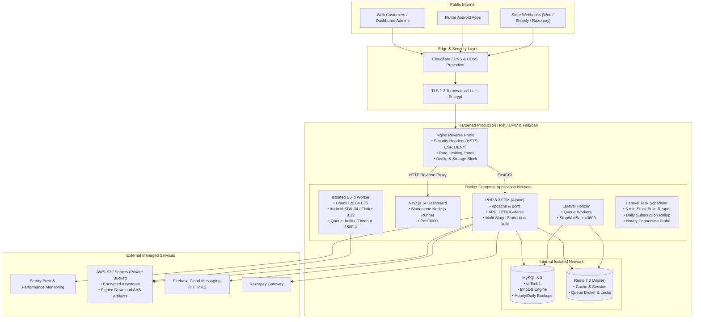

# Appify Production Deployment & Operations Guide

This document defines the production infrastructure topology, container specifications, security hardening procedures, zero-downtime deployment workflows, disaster recovery protocols, and the pre-launch verification checklist for the Appify white-label multi-tenant platform.

---

## 1. System Architecture & Topology



---

## 2. Multi-Stage Docker Configurations

The production environment utilizes hardened, minimal multi-stage Docker images to minimize surface area and image size.

### 2.1 Backend API (`backend/Dockerfile`)
- **Stage 1 (Composer Builder)**: Installs production PHP dependencies (`composer install --no-dev --optimize-autoloader --no-interaction`).
- **Stage 2 (Runtime)**: Based on `php:8.3-fpm-alpine`. Installs only necessary extensions (`pdo_mysql`, `redis`, `opcache`, `pcntl`, `gd`, `bcmath`, `zip`).
- **Security**: Runs under an unprivileged user `appify` (UID 1000). Root execution is explicitly forbidden. Uses `tini` as init process to prevent zombie processes.
- **PHP Optimization**: OPcache preloading enabled, memory limit set to 512M, `expose_php = Off`.

### 2.2 Dashboard Frontend (`dashboard/Dockerfile`)
- **Stage 1 (Deps)**: `node:20-alpine` with frozen lockfile.
- **Stage 2 (Builder)**: Builds Next.js in `standalone` output mode.
- **Stage 3 (Runner)**: Minimal Alpine image with unprivileged `nextjs` user (UID 1001), serving standalone bundles via `node server.js`.

### 2.3 Isolated Build Worker (`infra/build-worker/Dockerfile`)
- **Base**: `ubuntu:22.04` LTS.
- **Toolchain**: OpenJDK 17, Android Command-line Tools 34.0.0, Android Platforms 34, Build-tools 34.0.0, Flutter 3.22.x stable.
- **Isolation Guarantees**:
  - Runs as an unprivileged user `builder` (UID 1000).
  - No network access to internal admin endpoints.
  - Template repository cloned from trusted read-only cache; NEVER executes dynamic bash scripts or arbitrary code submitted by tenants.
  - Strict compile timeout: 1800 seconds (30 minutes).

---

## 3. Nginx Hardening & Security Headers

Configured in `infra/nginx/production.conf`.

### 3.1 Mandatory Security Headers
All responses from Nginx include:
```nginx
add_header Strict-Transport-Security "max-age=63072000; includeSubDomains; preload" always;
add_header X-Content-Type-Options "nosniff" always;
add_header X-Frame-Options "DENY" always;
add_header Referrer-Policy "strict-origin-when-cross-origin" always;
add_header Permissions-Policy "camera=(), microphone=(), geolocation=(), payment=()" always;
add_header Content-Security-Policy "default-src 'none'; frame-ancestors 'none'; base-uri 'none'; form-action 'self';" always;
```

### 3.2 Information Leakage Prevention & Hidden Files
```nginx
server_tokens off;
fastcgi_hide_header X-Powered-By;

# Block git, env, and dotfiles
location ~ /\.(?!well-known).* {
    deny all;
    access_log off;
    log_not_found off;
    return 404;
}

# Block storage, vendor, and tests from web access
location ~ ^/(storage|vendor|bootstrap/cache|node_modules|tests)/ {
    deny all;
    return 404;
}

# Block database dumps and log extensions
location ~* \.(sql|bak|inc|old|orig|dist|env|log)$ {
    deny all;
    return 404;
}
```

### 3.3 Rate Limiting Zones
```nginx
limit_req_zone $binary_remote_addr zone=api_general:10m rate=60r/s;
limit_req_zone $binary_remote_addr zone=auth_limit:10m rate=5r/m;
limit_req_zone $binary_remote_addr zone=otp_limit:10m rate=3r/m;
```

---

## 4. Production Environment Configuration

The production `.env` file must strictly enforce the following settings:

| Variable | Required Production Value | Purpose |
| :--- | :--- | :--- |
| `APP_ENV` | `production` | Enables production error handling |
| `APP_DEBUG` | `false` | **CRITICAL**: Disables stack traces and debug output |
| `LOG_LEVEL` | `error` or `warning` | Suppresses verbose debug entries in production logs |
| `SESSION_SECURE_COOKIE` | `true` | Ensures session cookies transmit only over HTTPS |
| `SESSION_ENCRYPT` | `true` | Cryptographically encrypts session payloads |
| `CREDENTIAL_VAULT_KEY` | 32-byte secure random hex | Encrypts tenant store API keys in database |
| `BUILD_TIMEOUT_SECONDS`| `1800` | Limits build worker execution to 30 minutes |
| `SENTRY_LARAVEL_DSN` | `https://...@sentry.io/...` | Sentry exception and performance monitoring |

---

## 5. Supervisor Process Management

Supervisor runs as PID 1 inside the worker containers (`infra/supervisor/supervisord.conf`):

1. **`program:php-fpm`**: Master FastCGI process handling API web traffic.
2. **`program:horizon`**: Laravel Horizon managing queues (`default`, `webhooks`, `notifications`). Configured with `stopwaitsecs=3600` to allow running background jobs to conclude gracefully on deploys.
3. **`program:build-worker`**: Dedicated worker running `php artisan queue:work --queue=builds --timeout=1800 --tries=1 --memory=1024`. Limited to 2 concurrent processes per server to prevent CPU starvation.
4. **`program:cron-scheduler`**: Lightweight loop executing `php artisan schedule:run` every 60 seconds.

---

## 6. Scheduled Background Tasks (`backend/routes/console.php`)

| Task Name | Interval | Description |
| :--- | :--- | :--- |
| `reap-stuck-builds` | Every 5 minutes | Identifies builds running > 45 minutes and transitions them to `timed_out` |
| `subscription-expiry-check` | Daily at 00:05 | Flags expired subscriptions as `past_due` and locks entitlements |
| `connection-health-probe` | Hourly | Audits active WooCommerce/Shopify connections and logs degradation alerts |
| `prune-expired-tokens` | Daily | Purges expired Laravel Sanctum access tokens (`--hours=48`) |

---

## 7. Health Endpoints & Load Balancer Probing

- **URL**: `GET https://api.appify.dev/health` (also accessible via `/api/health`)
- **Controller**: [HealthCheckController](file:///d:/Appify/backend/app/Http/Controllers/Api/HealthCheckController.php)
- **Subsystem Probes**:
  1. **Database**: Executes PDO connection test (`DB::connection()->getPdo()`).
  2. **Redis**: Executes ping command (`Redis::connection()->ping()`).
  3. **Storage**: Performs atomic write, read, and delete test on private storage disk.
- **Response Format**:
  - `200 OK`: `{"status":"healthy","checks":{"database":"ok","redis":"ok","storage":"ok"}}`
  - `503 Service Unavailable`: `{"status":"degraded","checks":{...}}`
- **Nginx Optimization**: `location = /health` suppresses access log writes to avoid flooding log disks during high-frequency LB probes.

---

## 8. Log Rotation (`infra/logrotate/appify.conf`)

Install on the host system:
```bash
sudo cp infra/logrotate/appify.conf /etc/logrotate.d/appify
sudo chmod 0644 /etc/logrotate.d/appify
```
- **Rotates**:
  - `/var/www/storage/logs/*.log` (Daily, 14 days retention, gzip, copytruncate)
  - `/var/log/nginx/*.log` (Daily, 14 days retention, USR1 signal reload)
  - `/var/log/supervisor/*.log` (Weekly, 8 weeks retention, gzip)

---

## 9. Database Backup & Disaster Recovery

### 9.1 Automated Backup (`infra/scripts/backup-db.sh`)
```bash
# Executed daily via host cron:
0 2 * * * /var/www/appify/infra/scripts/backup-db.sh /var/backups/appify/mysql
```
- Executes `mysqldump` with `--single-transaction`, `--quick`, `--routines`, and `--triggers`.
- Streams output directly to `gzip -9`.
- Verifies archive integrity using `gzip -t`.
- Automatically prunes local backup archives older than 30 days.

### 9.2 Restore Procedure (`infra/scripts/restore-db.sh`)
```bash
# Interactive restore (requires typing 'RESTORE' confirmation)
/var/www/appify/infra/scripts/restore-db.sh /var/backups/appify/mysql/appify_20261013_020000.sql.gz

# Automated / CI restore
/var/www/appify/infra/scripts/restore-db.sh /var/backups/appify/mysql/appify_20261013_020000.sql.gz --force
```
- Performs safety check to ensure backup file exists and archive is not corrupted.
- Disables `FOREIGN_KEY_CHECKS` and `UNIQUE_CHECKS` during streaming import for atomicity and speed.
- Re-enables foreign key constraints upon completion and reports total restored table count.

---

## 10. Server Hardening Checklist (UFW & SSH)

### 10.1 Firewall (UFW) Hardening
```bash
# 1. Reset defaults to deny all incoming, allow all outgoing
sudo ufw default deny incoming
sudo ufw default allow outgoing

# 2. Allow SSH only from specific admin IP / VPN subnet (or limit rate)
sudo ufw limit 22/tcp comment 'SSH with rate limit'

# 3. Allow HTTP and HTTPS
sudo ufw allow 80/tcp comment 'HTTP (Let\'s Encrypt)'
sudo ufw allow 443/tcp comment 'HTTPS'

# 4. Explicitly block external access to MySQL and Redis
sudo ufw deny 3306/tcp comment 'Block external MySQL'
sudo ufw deny 6379/tcp comment 'Block external Redis'

# 5. Enable firewall
sudo ufw enable
sudo ufw status verbose
```

### 10.2 SSH Daemon Hardening (`/etc/ssh/sshd_config`)
```ini
# Disable root login
PermitRootLogin no

# Disable password authentication (SSH Key only)
PasswordAuthentication no
PubkeyAuthentication yes

# Restrict allowed key types to modern curves
HostKeyAlgorithms ssh-ed25519,ssh-ed25519-cert-v01@openssh.com

# Disable empty passwords and X11 forwarding
PermitEmptyPasswords no
X11Forwarding no

# Connection timeout guards
ClientAliveInterval 300
ClientAliveCountMax 2
MaxAuthTries 3
```
After editing: `sudo sshd -t && sudo systemctl restart sshd`

### 10.3 Fail2Ban Protection
Install and configure `/etc/fail2ban/jail.local`:
```ini
[sshd]
enabled = true
port = 22
maxretry = 3
bantime = 1d
findtime = 10m

[nginx-req-limit]
enabled = true
filter = nginx-limit-req
logpath = /var/log/nginx/api_error.log
findtime = 600
maxretry = 10
bantime = 7200
```

---

## 11. Zero-Downtime Deployment Workflow

All production deployments are automated using `infra/scripts/deploy.sh`:

```bash
cd /var/www/appify
./infra/scripts/deploy.sh
```

### Execution Steps:
1. **Pre-flight Checks**: Verifies `.env` exists and validates that `APP_DEBUG=false`.
2. **Container Build**: Builds production Docker images (`docker compose build --pull`).
3. **Database Migration**: Executes `php artisan migrate --force` inside isolated runner.
4. **Cache Warming**:
   - `php artisan config:cache`
   - `php artisan route:cache`
   - `php artisan view:cache`
   - `php artisan event:cache`
5. **Rolling Reload**: Reloads PHP-FPM and Next.js containers without dropping connections.
6. **Worker Cycling**: Gracefully terminates Horizon (`php artisan horizon:terminate`). Supervisor automatically spawns new worker processes loaded with latest code.
7. **Nginx Reload**: Signals Nginx (`nginx -s reload`) to apply any proxy updates.
8. **Health Check Probe**: Automatically polls `https://api.appify.dev/health` up to 15 times. If the probe fails, it immediately initiates an automatic rollback!

---

## 12. Rollback Plan & Runbook

If a deployment fails the health check or introduces critical regression:

### Automated Rollback:
The deployment script triggers `infra/scripts/rollback.sh` automatically upon failed health probes.

### Manual Rollback Procedure:
```bash
cd /var/www/appify

# Option A: Standard rollback (restores previous containers and flushes cache)
./infra/scripts/rollback.sh

# Option B: Emergency rollback including database migration revert
./infra/scripts/rollback.sh --rollback-migrations
```

### Rollback Runbook Actions:
1. If database migrations were broken, run `php artisan migrate:rollback --step=1 --force`.
2. Flush all stale caches: `cache:clear`, `config:clear`, `route:clear`, `view:clear`.
3. Re-cache verified baseline configuration.
4. Issue `php artisan horizon:terminate` to clear in-flight jobs on workers.
5. Restart application services (`docker compose restart php dashboard nginx`).
6. Query `/health` endpoint to verify system stability.

---

## 13. Pre-Launch Verification Checklist

Before taking the production platform live for public tenants:

### A. Security & Access
- [ ] `APP_DEBUG=false` confirmed in `backend/.env`.
- [ ] `APP_ENV=production` set.
- [ ] `CREDENTIAL_VAULT_KEY` generated with 32 cryptographically secure random bytes.
- [ ] SSH root login disabled; password authentication disabled.
- [ ] UFW active: only ports 80, 443, and restricted 22 open.
- [ ] MySQL (3306) and Redis (6379) bound only to internal Docker bridge (`127.0.0.1` / internal network).
- [ ] Sentry DSN configured; `send_default_pii=false` and SQL query bindings disabled.
- [ ] Nginx security headers confirmed via `curl -I https://api.appify.dev`:
  - `Strict-Transport-Security` present with `preload`
  - `X-Frame-Options: DENY`
  - `X-Content-Type-Options: nosniff`
  - `Referrer-Policy: strict-origin-when-cross-origin`
  - `Content-Security-Policy` present

### B. Infrastructure & Orchestration
- [ ] Multi-stage Docker containers built and running cleanly without root privileges.
- [ ] Horizon dashboard accessible only to super-admins via Filament.
- [ ] Supervisor active with `php-fpm`, `horizon`, `build-worker`, and `cron-scheduler` in `RUNNING` state.
- [ ] Logrotate installed in `/etc/logrotate.d/appify` and dry-run validated (`logrotate -d /etc/logrotate.d/appify`).
- [ ] Healthcheck endpoint (`/health`) returns HTTP 200 with all subsystems `ok`.

### C. Database & Backup
- [ ] Database migrations executed cleanly up to latest batch.
- [ ] Backup script (`infra/scripts/backup-db.sh`) tested and verified with `gzip -t`.
- [ ] Cron job scheduled for daily 02:00 AM database backups.
- [ ] Offsite backup replication configured (S3/Rclone).

### D. Build Pipeline Isolation
- [ ] Dedicated build worker container running with Android SDK 34 & Flutter 3.22.
- [ ] Unprivileged `builder` user verified; build timeout enforced at 1800s.
- [ ] Generated keystores and AAB artifacts verified in isolated storage path: `tenants/{tenant_id}/...`.
- [ ] Signed download endpoint verified: direct URL access rejected without HMAC signature.

### E. Billing & Payment Gateway
- [ ] Razorpay production Key ID and Secret configured in environment.
- [ ] Razorpay webhook URL registered: `https://api.appify.dev/webhooks/razorpay`.
- [ ] Webhook signature verification verified with automated test.
- [ ] Idempotency confirmed: replayed webhooks return 200 without duplicate billing credits.

### F. Push Notifications & WhatsApp
- [ ] Firebase Service Account JSON file stored in private location with restricted file permissions (`chmod 600`).
- [ ] FCM HTTP v1 batch processing verified via Horizon queue.
- [ ] WhatsApp Cloud API access token and Phone Number ID configured.
- [ ] WhatsApp delivery webhook registered: `https://api.appify.dev/webhooks/whatsapp`.
